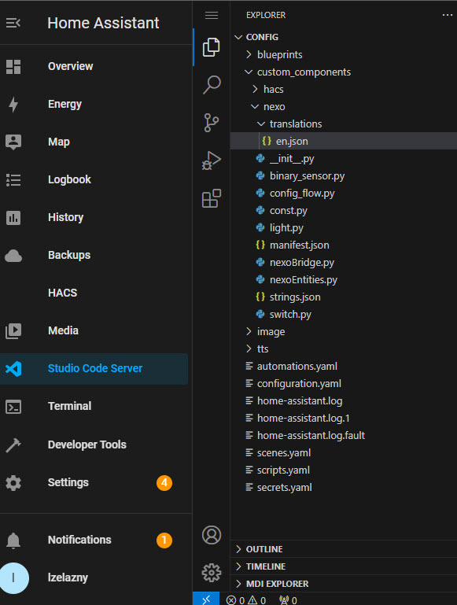
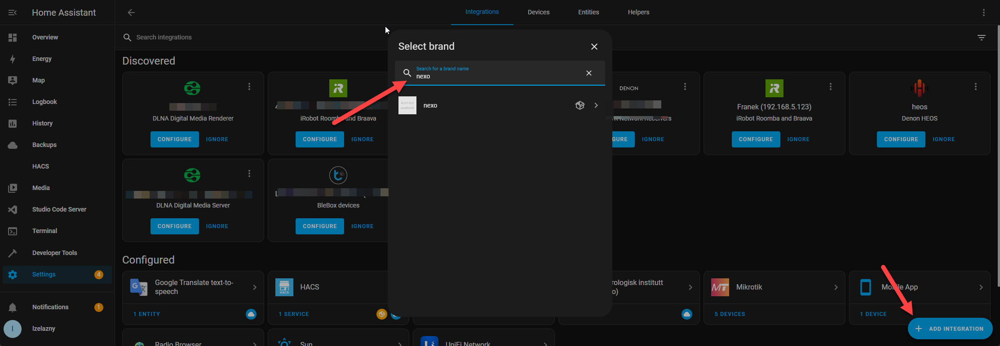
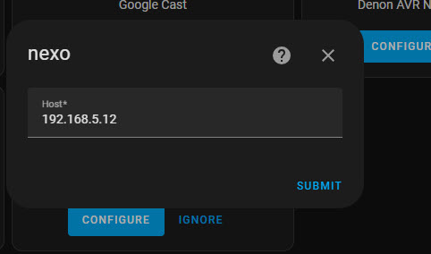
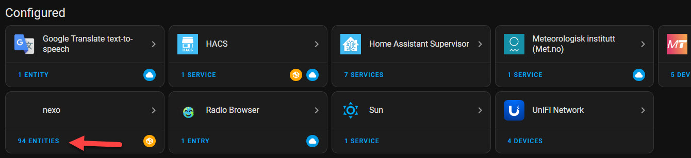

# hacs_nexo – Unofficial Home Assistant Integration for Nexwell/Nexo System

**Simple, unofficial integration for exposing devices managed by the Nexwell/Nexo system via the Multimedia Card.**

## Supported Features

This integration currently supports:

- **Lights and LEDs** – On/Off and brightness for dimmable resources
- **Dimmers and lighting groups** – Brightness, including LED groups
- **Switches and output groups** – On/Off
- **Binary Sensors** – On/Off  
- **Analog Sensors**
- **Blinds** – Open / Close / Stop / Set Position
- **Temperature**
- **Thermostats**  
- **Gates**  
- **Alarm Partitions**
- **Local weather station** – Temperature, wind and light observations
- **External commands** – Buttons for Nexo automations

### External command buttons

Commands announced by the bridge are added automatically, including commands
received after startup. To add command names manually, open the Nexo integration's
**Configure** page and enter comma separated names under
**Saved command names**.
Saving options reloads that integration entry. Each button targets its own bridge
and uses the current connection after reconnecting.

### Nexo control page

Open the gear on the Nexo integration to access one page with three collapsible
sections: **General Information**, **Send command**, and
**Inspect Init JSON**. The page has no sidebar entry and selects the bridge whose gear
you opened. Administrators can send a known or manually entered command, save
comma separated command names for button entities, and search, copy or download
the latest `initial_data` response. Saving command names reloads that bridge.

The overview shows the host, port, connection status, init receipt time, resource
counts by type, known command count and JSON size. The page refreshes every three
seconds. The snapshot is retained while reconnecting; reloading the integration
or restarting Home Assistant clears it until a new init response arrives.

The entry's **Download diagnostics** menu includes the snapshot with common
credential fields and the host redacted. The page's JSON download contains the
original payload; review it before sharing.

### Local weather

Weather observations come from the multimedia card's `set_weather` messages.
The weather entity becomes available when the station reports observations.
Temperature is reported in °C and wind speed in m/s, with unit conversion handled
by Home Assistant. No external forecast service is required.

## Installation

To install the integration:

1. **Copy the `nexo` folder** into your Home Assistant `custom_components` directory.

   

2. **Restart Home Assistant.**
3. Go to **Settings → Add Integration → nexo**.

   

4. **Enter the IP address** of your Nexwell Multimedia Card.

   
   
5. **You're all set! Enjoy your integration.**

   

    
## License

This project is licensed under the [Apache 2.0 License](https://github.com/lzelazny/hacs_nexo/blob/main/LICENSE).

